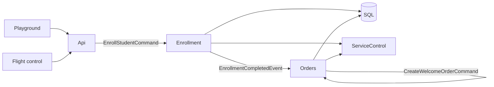
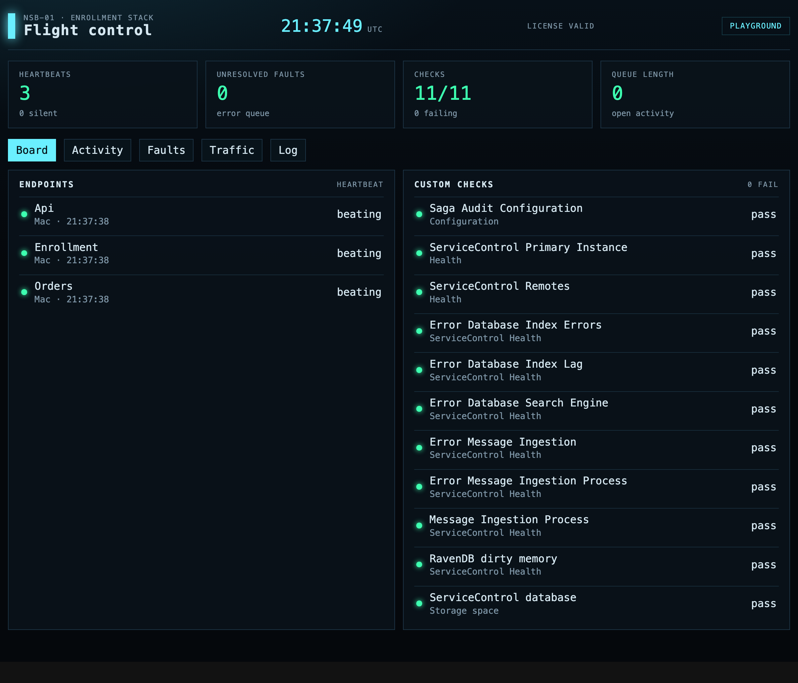
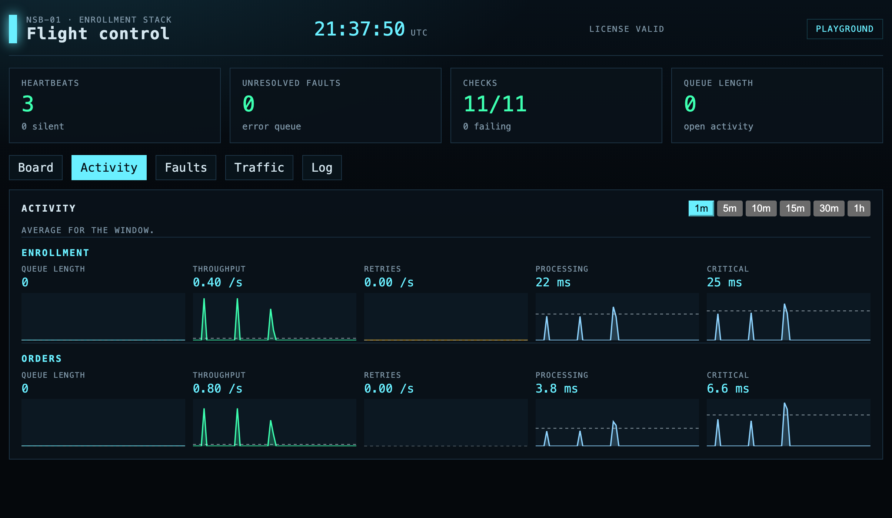

# Enrollment, finished on a message

An Aspire application that accepts an enrollment on HTTP and finishes it on NServiceBus. The API validates the form, returns **202 Accepted** with a tracking id, and sends one command. It does not write the row, and it does not use the outbox. The `Enrollment` endpoint writes SQL and, when the enrollment completes, publishes a fact. `Orders` turns that fact into its own command and writes the welcome order.

Local messaging is RabbitMQ. Publish uses Azure Service Bus with `DefaultAzureCredential`. Business data stays in SQL. Both transports receive with `TransportTransactionMode.ReceiveOnly`, so the SQL save is already visible to a poll: `404`, then `completed` or `rejected`.



## What is in the box

- A playground for the HTTP API, including a generator that posts 1–10 enrollments at a time. Each address carries a clock tick, so a new run does not reuse one.
- Flight control, a separate site. Opening it does not stop the generator. It reads the same ServiceControl error, audit, and monitoring instances as ServicePulse.
- Two NServiceBus endpoints in one worker process. The host does not name the handlers it runs.
- A beta queue gate: hold a command without failing it, or send a message straight to the error queue.
- The same endpoint code on RabbitMQ locally and Azure Service Bus when published.

A repeated tracking id is safe. A completed enrollment stays completed and publishes again. A second tracking id for an email that is already completed is stored as rejected. The filtered index `IX_Enrollments_CompletedEmail` still stops two completed rows for one email.

## Handlers register themselves

A feature is a folder. `EnrollStudent/` holds the use case, the handler, and an `AutoConfigureServices` marker. `Shared/` owns the database. Delete the feature folder and that handler is gone.

The worker discovers every `IFeatureHandlers` marker and starts one endpoint per destination. Assembly scanning is off. NServiceBus 10 generates `AddEnrollStudentCommandHandler()`, and the host invokes that method for handlers in the marker's namespace whose destination matches. `AddAll` is not used, so one assembly can place handlers on different endpoints.

The Endpoint project never names a feature type. The compiler drops a project reference the host does not mention, so discovery also loads the project assemblies listed in the host deps file. The Endpoint and API projects still reference Enrollment and Orders, which is what copies those assemblies next to the host.

```csharp
[Handler]
public sealed class EnrollStudentCommandHandler(EnrollStudent enroll, ...)
{
    public async Task Handle(EnrollStudentCommand message, IMessageHandlerContext context)
    {
        var outcome = await enroll.ProcessAsync(message, context.CancellationToken);
        if (outcome != EnrollmentOutcome.Completed)
        {
            return;
        }

        await context.Publish(completed);
    }
}
```

The handler logs, calls the use case, and publishes only when the outcome is completed. Shape checks stay on the API with FluentValidation and return `400` before the send. Duplicate email and a repeated tracking id are business outcomes inside `EnrollStudent`, not validation failures.

## A message names its endpoint

Commands carry `[RouteTo]`. Events do not. The handler that reacts to an event carries `[HandleOn]`. A name ending in `Command` is a command. A name ending in `Event` is an event. Message types do not implement an NServiceBus interface, and `src/Messages` does not reference NServiceBus.

| Message | Placed by | Endpoint |
| --- | --- | --- |
| `EnrollStudentCommand` | `[RouteTo("Enrollment")]` | Enrollment |
| `EnrollmentCompletedEvent` | `[HandleOn("Orders")]` on the handler | Orders |
| `CreateWelcomeOrderCommand` | `[RouteTo("Orders")]` | Orders |

The event handler only sends `CreateWelcomeOrderCommand`. The command handler does the SQL write, and it is idempotent on the tracking id. One subscriber failing does not share a transaction with another subscriber's work.

## Pause a handler (beta)

App Configuration stores one string per endpoint and one per message under `Demo:Processing:`. A missing key means `running`. The worker refreshes the store about every 5 seconds. The playground Processing tab writes the keys.

| Mode | What happens |
| --- | --- |
| `running` | The handler runs. |
| `pause` | Commands only. The handler does not run. The command is sent back to this endpoint with a 30 second delay and a new message id. It does not go to the error queue. |
| `error` | The pipeline throws `RoutedToErrorException` before the handler. NServiceBus skips retries and moves that endpoint's copy to the error queue. |

An event is a fact, so pause does not apply to it. An endpoint set to `error` covers every message on that endpoint. Set a paused command back to `running` and the next 30 second delivery is handled.

This is beta because the host is `ReceiveOnly` and has no outbox. The delayed copy and the acknowledgement of the original delivery are not one transaction. Handlers are idempotent on the tracking id, so a duplicate delivery does not write a second row. A paused command does not show up as a failed message. `error` does.

## Run

```bash
dotnet run --project src/AppHost
```

Docker must be running. The first start pulls RabbitMQ, SQL Server, ServiceControl, ServicePulse, and RavenDB. Open the **web** resource for the playground and the **flight** resource for flight control. Stock ServicePulse is `particular-servicepulse`.

```bash
dotnet test
```

HTTP tests use `WebApplicationFactory` and do not start NServiceBus. Enrollment and order tests use the EF in-memory provider. Todos tests start a SQL Server Testcontainer.

## Flight control

Same ServiceControl data as ServicePulse, drawn as a control room. The number on each chart is the average for the selected window. Hover a chart for the sample under the pointer. History matches ServicePulse: 1 minute through 1 hour.

The board is heartbeats, the error queue, and ServiceControl's own checks.



Activity is queue length, throughput, retries, processing time, and critical time. This window is one minute of enrollments from the playground generator.



## Projects

| Project | Owns |
| --- | --- |
| `Messages` | Message types. Namespace `Messages`. No NServiceBus package. |
| `Routing` | `[RouteTo]`, `[HandleOn]`, and the command/event name rules. |
| `Endpoint.Extensions` | Feature discovery, handler logging, and the queue-gate rules. No NServiceBus package. |
| `Transport` | RabbitMQ when the connection starts with `amqp://` or `amqps://`. Otherwise Azure Service Bus. |
| `Enrollment`, `Orders` | Feature folders and their databases. |
| `Endpoint` | The generic worker. One process, one NServiceBus endpoint per destination. |
| `Api` | Send-only endpoint `Api`. Validates, returns 202, reads SQL. |
| `Web` | The playground. |
| `Flight` | Flight control. |
| `AppHost` | Aspire. Local RabbitMQ, publish Azure Service Bus. |
